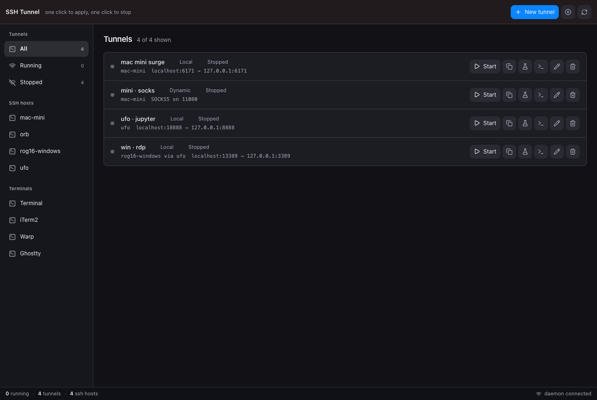
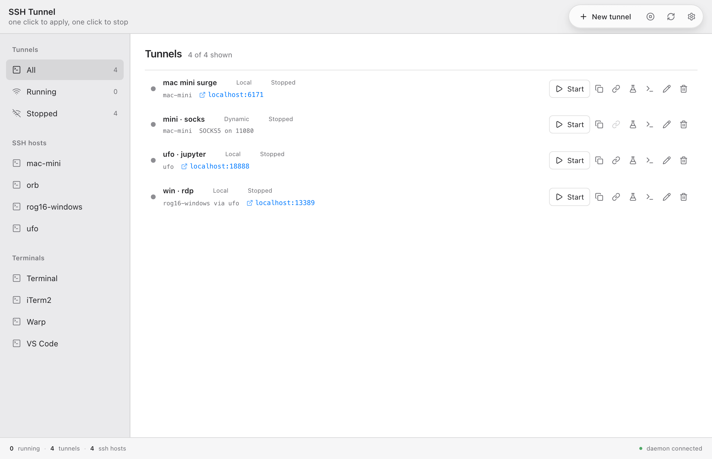
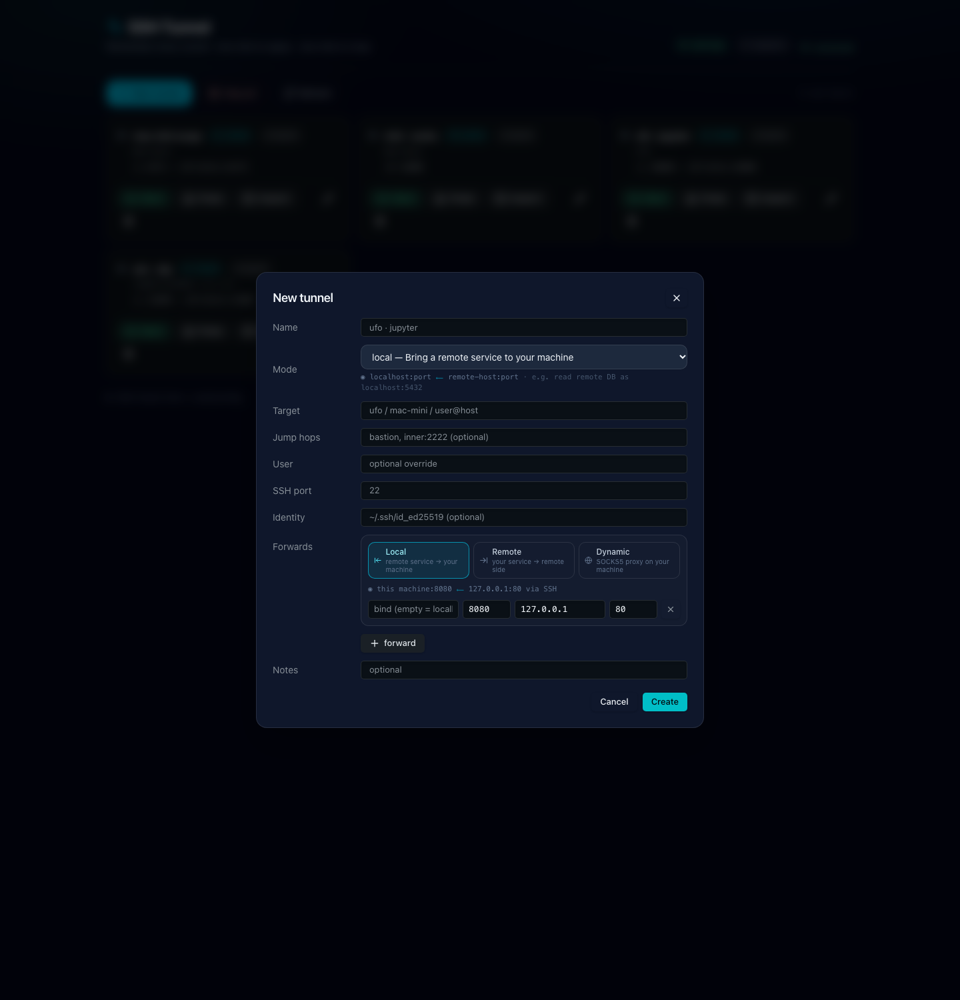
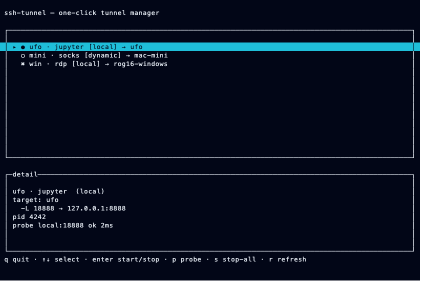
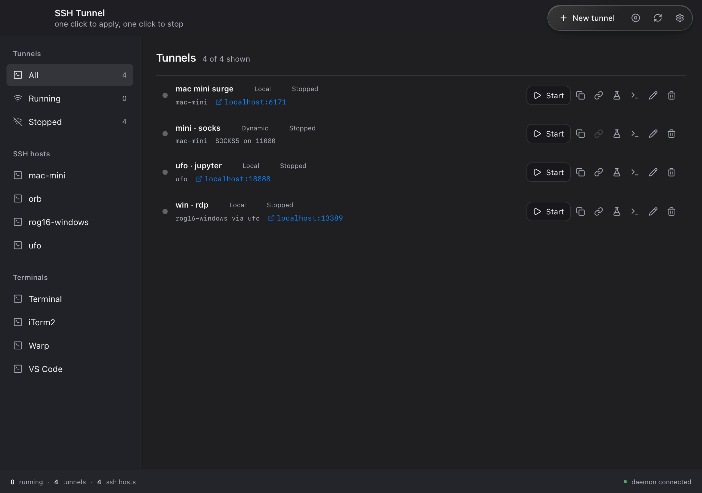

# ssh-tunnel-ui

[](https://github.com/HuakunShen/ssh-tunnel-ui/actions/workflows/ci.yml)
[](https://github.com/HuakunShen/ssh-tunnel-ui/actions/workflows/release.yml)

A one-click SSH tunnel manager: remember every tunnel, start/stop with a keypress.

## Install

Download `SSH-Tunnel-macos-arm64.dmg` from
[Releases](https://github.com/HuakunShen/ssh-tunnel-ui/releases) and drag the app
to Applications. The build is ad-hoc signed, not notarized, so the first launch
needs right-click > Open (or `xattr -dr com.apple.quarantine "/Applications/SSH Tunnel.app"`).

The app carries its own daemon, the Web UI and the icon: once copied it runs
without this repository next to it.

## Gallery

| Web console — dark | Web console — light |
|---|---|
|  |  |



| Terminal UI (OpenTUI) | Desktop app (Tauri) |
|---|---|
|  |  |

The TUI ships as SVG too (`screenshots/tui-list.svg`, regenerated by
`bun ./scripts/shot.ts` in `apps/tui` — memory frames, no TTY needed).

Monorepo with **one portable backend** consumed by many thin fronts:

```
packages/ssh-contract   — closed error codes, zod schemas, HTTP/WS contract (host-free)
packages/ssh-core       — tunnel model, ssh argv builder, validation, state machine (host-free)
packages/ssh-client     — typed fetch client for the HTTP API (host-free)
packages/ssh-host-node  — Node host: process spawn/monitor, TCP health check, JSON store, SSH config read, terminal discovery (host)
packages/ssh-service    — composition root: store + manager + HTTP server (Hono) (host)
apps/server             — `ssh-tunnel-serve` daemon binary (composition, argv only)
apps/cli                — `ssh-tunnel` CLI: direct-mode + server-mode (composition)
apps/tui                — `ssh-tunnel-tui` fullscreen TUI over OpenTUI+React (thin front)
apps/web                — Svelte 5 console (static SPA served by the daemon)
apps/desktop            — Tauri shell stub wrapping the Web UI (thin front)
integrations/dsh        — DeepSeek Harness plugin stub (thin front)
integrations/vscode     — VS Code extension stub (thin front)
```

## Why TypeScript

Backend is management-plane only (profile CRUD, `ssh -N` process supervision,
TCP dial health checks, JSON persistence, HTTP API). The data plane stays in
system OpenSSH, so language barely matters for performance — TS wins on
cross-platform fronts (TUI via OpenTUI, Web UI, DSH/VS Code plugins share the
contract + client with zero rewrite). One `pnpm install`, one `tsc`, one test
suite covers all fronts.

## Tunnel kinds supported

| kind | ssh flag | meaning |
|---|---|---|
| `local` | `-L [bind:]port:host:hostport` | expose remote service locally |
| `remote` | `-R [bind:]port:host:hostport` | expose local service remotely |
| `dynamic` | `-D [bind:]port` | local SOCKS5 proxy |
| `jump` | `-J hop1,hop2` + target | reach host via bastion(s) |
| `socks-via-remote` | `-R` carrying SOCKS | reverse SOCKS (documented preset) |

Every profile additionally supports: multiple `-L/-R/-D` forwards in one
tunnel, `-J` jump hops, extra `-o` options, `ServerAliveInterval`,
private-key path, `ExitOnForwardFailure`, `ClearAllForwardings`, local/remote
command execution (`-N` default), and GatewayPorts awareness for `-R`
bind addresses.

## The ssh command, and "Open in…"

Every profile carries its exact equivalent command. The console shows it in
the editor, and two affordances act on it:

- **Copy command** puts the equivalent `ssh …` line on the clipboard — run it
  anywhere, including a machine with no daemon.
- **Open in ▾** lists the terminals actually installed on *this* machine
  (`GET /api/terminals`) — Terminal, iTerm2, Warp, Ghostty, kitty, WezTerm,
  Alacritty, VS Code on macOS; GNOME Terminal, Konsole, Alacritty, kitty, XTerm
  on Linux; Windows Terminal and PowerShell on Windows. Detection is pure
  filesystem probing (`.app` bundle on macOS, executable on PATH elsewhere) and
  nothing is probed until you click.

The daemon spawns that terminal itself (`POST /api/profiles/:id/launch`), so
the session is ours to end: relaunching a profile replaces the tracked window,
deleting it closes it, and `DELETE /api/profiles/:id/session` closes it on
demand. Health still comes from TCP probing the forwarded ports, never from the
process tree — so a window you close by hand is reported as stopped, not as a
failure.

## Quickstart

```sh
pnpm install
pnpm check        # tsc --noEmit everywhere (16 workspace members)
pnpm check:boundaries
pnpm test         # vitest, every suite
pnpm test:ci      # the same minus the TUI render snapshots (see below)
pnpm build        # esbuild bundles for server/cli/tui + static web dist

# daemon + web UI
node apps/server/dist/server.mjs --port=7432 --web-dir=apps/web/dist
# http://127.0.0.1:7432  (API at /api/*, Web UI at /)
# TUI (talks to daemon, or `ssh-tunnel-tui --direct` for standalone)
node apps/tui/dist/tui.mjs
# CLI (daemon mode default, `--direct` embeds the manager)
node apps/cli/dist/cli.mjs list
```

`pnpm test` also runs the TUI snapshot tests, which need OpenTUI's native
renderer. That FFI is unavailable under this vitest setup, so those four
assertions fail locally and in CI; `pnpm test:ci` (what CI runs) excludes
`apps/tui/**` and everything else passes.

## Releases

`git tag v0.1.0 && git push origin v0.1.0` builds the daemon, the Web UI and the
Tauri shell on a macOS runner, then attaches a `.dmg` and a `.zip` to a GitHub
Release. A manual run of the workflow builds the same artifacts without
publishing them. Signing and notarization turn on by adding `APPLE_CERTIFICATE`,
`APPLE_CERTIFICATE_PASSWORD`, `APPLE_SIGNING_IDENTITY`, `APPLE_ID`,
`APPLE_PASSWORD` and `APPLE_TEAM_ID` as repository secrets.

## Status (verified live 2026-10-11)

Local / remote / dynamic-SOCKS / jump / multi — all exercised against real
hosts (`ufo` Ubuntu, `mac-mini`, `rog16-windows` with OpenSSH_for_Windows):
see `docs/design.md` for the evidence table. TUI renders (OpenTUI, `n` creates,
`d` deletes, full-row highlight), Web UI is a Svelte 5 console served by the
daemon, Tauri shell + DSH plugin + VS Code extension are real over the same
typed client. uniview is tracked as a submodule with a React-level spike
(`docs/uniview-spike.md`, feedback in `docs/uniview-feedback.md`).

## Layout rules (machine-checked)

- Portable packages (`ssh-contract`, `ssh-core`, `ssh-client`) must not import
  `node:*`, DOM, or host packages — `pnpm check:boundaries` enforces it.
- `apps/*` hold composition + argv parsing only; no domain logic.
- Internal deps are `workspace:*`; third-party versions live in the root catalog.
- Internal packages export TS source directly (`./src/index.ts`), no build.
  Only runnable artifacts (server/cli/tui bundles) use esbuild single-file output.
